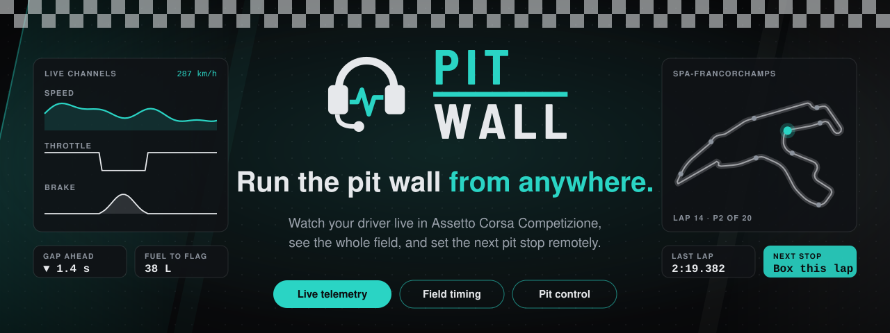
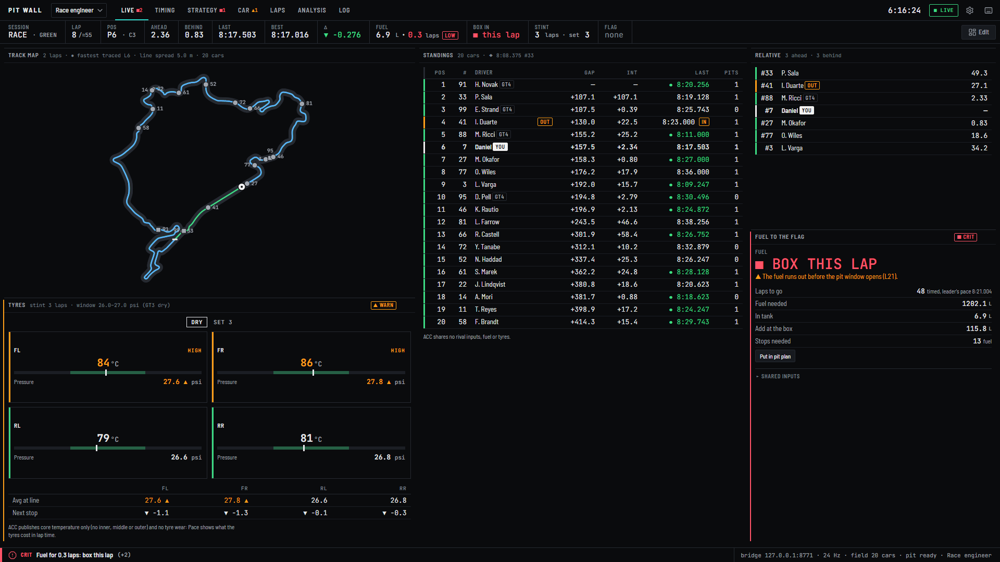

<p align="center">
  
</p>

<p align="center">
  <b>One person drives. The engineer, on another PC, watches the car live in a browser<br>and sets the next pit stop straight into the driver's game.</b>
</p>

<p align="center">
  <a href="#what-you-get">What you get</a> ·
  <a href="#get-started">Get started</a> ·
  <a href="#connect-the-two-pcs">Connect the PCs</a> ·
  <a href="#try-the-demo">Try the demo</a> ·
  <a href="docs/GUIDE.md">Guide</a>
</p>

<p align="center">
  
</p>

## What you get

| | |
|---|---|
| **Live car** | Laps, sectors, fuel, tyres, brakes, damage and driver inputs, updating many times a second. |
| **Whole-field timing** | Standings, gaps and intervals, relative, battle, pit lane and every car on the track map. |
| **Strategy, worked out for you** | When to box, how much fuel to add, how many stops are left and where you'll rejoin. |
| **Remote pit stop** | The engineer sets fuel, tyres, compound, pressures, brake pads and repairs. Pit Wall enters it in the driver's game and checks it went in. |
| **Your own layout** | Drag-and-drop screens, ready-made templates and your own colours. Works on a phone, too. |
| **3D damage view** | A GT3 painted green to red by what ACC reports for each zone. |
| **Private by design** | Runs on the driver's PC and connects over your own VPN. No account, no cloud. |

<p align="center">
  
</p>

## Get started

**Driver's PC** (Windows, where ACC runs). You need [Node.js](https://nodejs.org) 20 or newer and [pnpm](https://pnpm.io).

```bash
git clone https://github.com/simdex-org/pit-wall
cd pit-wall
pnpm install
pnpm --filter @pitwall/bridge start --http 25.x.x.x:8765
```

Use your VPN address in place of `25.x.x.x` (see [Connect the two PCs](#connect-the-two-pcs)). The bridge prints the link for the engineer:

```
Engineer, open:   http://25.40.144.183:8765/?key=4oX0dSGyk-ZpSt5I3lZq0w
```

**Engineer's PC:** open that link. Nothing to install, only a browser.

Then start ACC and drive. Only people with the key in the link can send pit plans; everyone else can just watch.

**Once, with ACC closed**, switch on timing for the other cars:

```bash
pnpm --filter @pitwall/bridge start --enable-broadcast
```

## Connect the two PCs

The engineer's browser reaches the driver's PC on port **8765** over a VPN. Nothing is opened to the internet.

1. Install [Hamachi](https://vpn.net/) on both PCs and sign in.
2. Driver: *Network → Create a new network*. Engineer: *Network → Join an existing network*.
3. The driver's `25.x.x.x` address at the top of the Hamachi window is the one to pass to `--http`.
4. Driver, once, in PowerShell **as administrator**, so Windows does not treat Hamachi as a public network:

   ```powershell
   Set-NetConnectionProfile -InterfaceAlias "Hamachi" -NetworkCategory Private
   ```

   Then allow Node on **Private** networks only when Windows asks.

**ZeroTier:** join both PCs to one network, authorise both, use the driver's ZeroTier address. **Tailscale:** same account on both, use the driver's `100.x.x.x` address.

## Try the demo

No ACC needed: a pretend race with a 20-car field and a working pit page.

```bash
pnpm --filter @pitwall/bridge start --simulate-acc --key demo
```

| Variant | Add |
|---|---|
| Qualifying | `--sim-session quali` |
| Nordschleife 24h, 8x faster | `--sim-track nordschleife --sim-speed 8` |
| Another real layout | `--sim-track spa` (or `monza`, `silverstone`, `suzuka`, and 20 more) |

<p align="center">
  
</p>

## Good to know

- Pit Wall works the pit menu the way a driver would, with the keys. ACC has to be the window in focus, and a plan takes 15 to 30 seconds to go in.
- It has been tested against a simulated race, not yet in a live one. **Try it once in practice before a race.**
- Driving on keyboard and mouse? See the [guide](docs/GUIDE.md#what-pit-control-can-and-cannot-do) for vJoy.

Everything else (every option, templates, the pit page, troubleshooting) is in the **[guide](docs/GUIDE.md)**.

## Credits

- 3D car: [three.js](https://github.com/mrdoob/three.js) 0.160.0, MIT. Fonts: [Barlow Semi Condensed](https://github.com/jpt/barlow) and [JetBrains Mono](https://github.com/JetBrains/JetBrainsMono), SIL OFL.
- ACC's shared memory layout: Kunos' *ACC Shared Memory Documentation* 1.8.12. The pitstop MFD layout and navigation: [Simulator Controller](https://github.com/SeriousOldMan/Simulator-Controller).
- Nürburgring 24h layout traced from Wikimedia Commons *Circuit Nürburgring-2002-24h.svg* (Pitlane02, CC BY-SA 3.0). Other outlines: © [OpenStreetMap contributors](https://www.openstreetmap.org/copyright), [ODbL](https://opendatacommons.org/licenses/odbl/1-0/).
