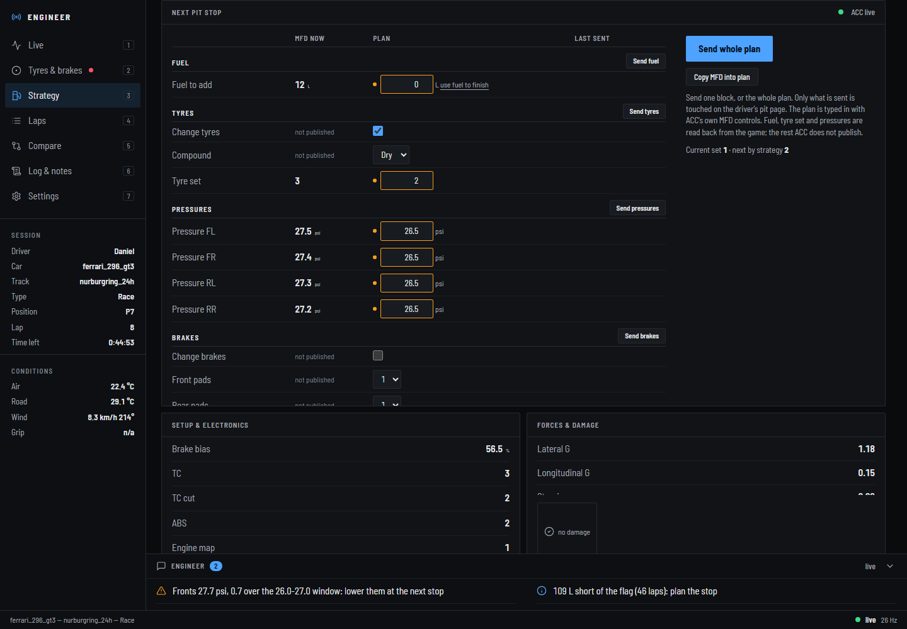
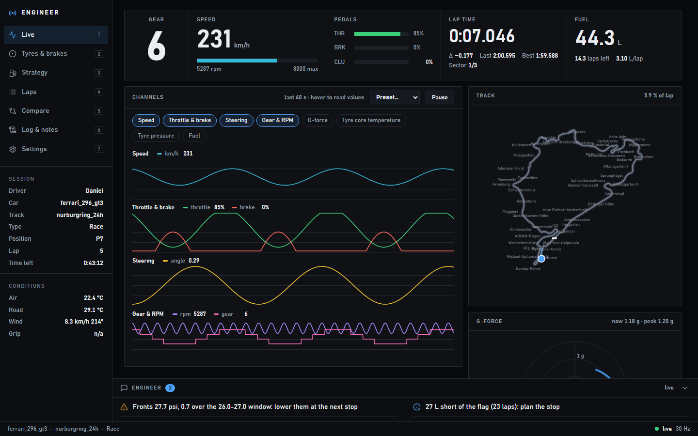

# Pit Wall

A live race-engineer dashboard for **Assetto Corsa Competizione**, with **remote pit stop control**.
One person drives; the engineer, on another PC anywhere over Hamachi (or ZeroTier, or Tailscale),
watches the car in a browser and sets the next pit stop (fuel, tyres, compound, pressures, brake pads and repairs)
straight into the driver's game.





Everything it needs is in this repository: it reads ACC's telemetry itself. No framework, no build,
nothing to install but Python.

---

## How it works, and what ACC allows

```
 DRIVER'S PC                                                          ENGINEER'S PC
 ACC ── shared memory ──> server/bridge.py (telemetry, advice, HTTP :8765) ══ Hamachi ══> browser
  ^                               │                                                        │
  └── MFD key presses (P, arrows) <── server/acc_pit.py <────── pit plan (with key) ──────┘
```

`server/bridge.py` runs on the driver's PC. It reads ACC's shared memory 30 times a second
(`server/acc_telemetry.py`), works out the laps, sectors, stint, fuel per lap and the engineer's advice,
and serves the dashboard to the engineer's browser.

ACC has **no API to write the pit strategy**. Its shared memory and its broadcasting API are read-only.
So pit control does what the driver would do with the keyboard: on the driver's PC it opens the
pitstop page of the MFD (the **P** key) and moves through it with the **arrow keys**.

What can be checked in the game afterwards is limited by what ACC publishes in its shared memory:

| MFD row | Set from the dashboard | Confirmed from the game |
|---|:---:|---|
| Fuel to add | ✅ | ✅ read back (`mfdFuelToAdd`) |
| Tyre set | ✅ | ✅ read back (`mfdTyreSet`) |
| Pressures FL / FR / RL / RR | ✅ | ✅ read back (`mfdTyrePressure*`) |
| Change tyres, compound (dry/wet) | ✅ | ✅ indirectly: by which MFD rows respond |
| Change brakes | ✅ | ✅ indirectly, the same way |
| Front / rear pad compound | ✅ | ❌ sent, not published by ACC |
| Repair suspension / bodywork | ✅ as a **switch** (yes ↔ no) | ❌ not published, so the dashboard cannot know the current state |
| Driver swap, pit strategy preset | ❌ | Not done: driver swap only exists in multi-driver events, and a strategy preset overwrites the values set here. |
| In-car electronics (TC, ABS, map, bias) | ❌ | Shown read-only on the Strategy tab. ACC only changes them from the car's own controls. |

Limits, plainly:

- **ACC must be the focused window on the driver's PC.** Keys are only sent while it is. If focus changes
  mid-way, pit control stops before pressing anything else and the dashboard says so. It never types into another program.
- **Applying a plan takes about 15 to 30 seconds**: it first finds out how the pit page is laid out
  (Strategy row or not, tyres changing or not, wet or dry, brakes changing or not), then sets each value
  and reads it back. The driver sees the MFD moving; they should not use the MFD keys meanwhile.
- **Driving on keyboard and mouse**: use **vJoy** (below). Without it, a key typed into the MFD makes ACC forget the gas, brake and
  steering keys the driver is holding, so the program only types while the driver holds none of them (lifting before a braking zone, coasting into a corner) and waits
  otherwise; the dashboard then says *applying, waiting for the driver to lift*. A plan can take a lap or two to go in this way, so send
  it early. A driving key pressed in the middle of an MFD keypress is pressed again until it is let go. To know which keys are held,
  the program watches only those (W, A, S, D and the gas, brake and steering keys in ACC's `controls.json`) with a keyboard hook;
  nothing else typed is seen. A few antivirus programs dislike keyboard hooks. On a wheel nothing waits.
- **The arrow keys and P must be ACC's MFD keys** (they are by default). If the driver rebound them,
  pass the pitstop key with `--pit-key`. Arrow keys must not be bound to anything else.
- Changes apply **without the driver confirming**: the engineer presses *Send* and it happens.
- The engineer's advice uses GT3 numbers: hot pressures 26.0–27.0 psi dry and 29.5–31.0 psi wet, brakes hot above 750 °C,
  pads low under 12 mm. Other classes need their own (`server/acc_telemetry.py`).
- The pit page layout was taken from how ACC 1.9/1.10 lays out the pitstop MFD and how
  [Simulator Controller](https://github.com/SeriousOldMan/Simulator-Controller) describes driving it. Telemetry and pit control are
  tested against a simulated session and a simulated MFD covering every layout (the self-tests below), not yet in a live race.
  **Test it once in a practice session before a race.**

---

## Install

**Driver's PC** (Windows; ACC runs here):

1. [Python 3.8 or newer](https://www.python.org/downloads/) (the Microsoft Store build works too).
2. This repository: *Code → Download ZIP* and unzip it, or `git clone https://github.com/simdex-org/pit-wall`.

**Engineer's PC**: only a browser.

Both PCs: the VPN, below.

## Connecting the two PCs with Hamachi

The engineer's browser reaches the driver's PC on port **8765** over the VPN. Nothing is opened to the internet.

1. Install [LogMeIn Hamachi](https://vpn.net/) on **both** PCs and sign in.
2. **Driver:** *Network → Create a new network*. Choose a network ID and a password.
3. **Engineer:** *Network → Join an existing network* with that ID and password.
4. On the driver's PC, the **IPv4 address** at the top of the Hamachi window (`25.x.x.x`) is the address the engineer will use.
5. **Driver, Windows firewall:** Windows files the Hamachi network as *Public*, and opening Python to every public network
   (café Wi-Fi included) is not what you want. Mark only Hamachi as private instead, once, in PowerShell **run as administrator**:

   ```powershell
   Set-NetConnectionProfile -InterfaceAlias "Hamachi" -NetworkCategory Private
   ```

   Then, the first time `bridge.py` starts, allow Python on **Private** networks only. Hamachi may need the command again after it
   reinstalls its adapter. (ZeroTier's and Tailscale's adapters are named differently: `Get-NetConnectionProfile` lists them.)

Using **ZeroTier** instead: create a network at my.zerotier.com, join it from both PCs with its network ID, tick *Auth* for both
members, and use the driver's ZeroTier address. With **Tailscale**: sign both PCs into the same account (or share the machine)
and use the driver's `100.x.x.x` address. Everything else is the same.

## Driver: running it

1. Start the bridge on your Hamachi address (the `25.x.x.x` at the top of the Hamachi window), in a terminal in this folder:

   ```bash
   python server/bridge.py --http 25.40.144.183:8765
   ```

   It then listens on the VPN only, not on your other networks. (Started without `--http` it is reachable from this PC only,
   and it prints the exact command with your address.) It prints the link for the engineer:

   ```
   Engineer, open:   http://25.40.144.183:8765/?key=4oX0dSGyk-ZpSt5I3lZq0w
   ```

   Send the engineer that link. The **key** is what allows sending pit plans; it changes on every start unless you fix it
   with `--key something-long`. Without the key the dashboard can be watched by members of your VPN network but not used to change anything.

2. Start ACC and drive. The terminal says when it sees the session (`ACC: ferrari_296_gt3 at nurburgring_24h, … driving`).
   Keep ACC as the focused window.

### Driving on keyboard and mouse: vJoy

Keys the program types into the MFD reach ACC as another keyboard, and ACC then forgets the gas and brake keys the driver is
holding. A virtual controller avoids that: the MFD buttons are pressed on it, and the driver's keyboard is never touched.

1. Install [vJoy](https://github.com/BrunnerInnovation/vJoy/releases) (free, open source). In *Configure vJoy*, device 1 needs at least
   5 buttons (the default 8 is fine).
2. Bind ACC's MFD to it, once. In a terminal in this folder:

   ```bash
   python server/acc_pit.py --bind-vjoy
   ```

   Switch to ACC, *Options → Controls*, and find the MFD actions. After 10 seconds the program presses each vJoy button for 10 seconds,
   announced by beeps: 1 beep **MFD pitstop page** (button 1), 2 beeps **MFD up** (2), 3 **MFD down** (3), 4 **MFD left** (4),
   5 **MFD right** (5). When you hear the beeps, click that action's binding in ACC; the button binds itself. Save the controls.
3. Start the bridge with `--vjoy`:

   ```bash
   python server/bridge.py --http 25.x.x.x:8765 --vjoy
   ```

   The keyboard MFD keys stay bound too, so the driver can still use them.

## Engineer: using it

1. Open the link the driver sent (`http://25.x.x.x:8765/?key=…`). The key is remembered by the browser, so later the plain address works.
2. The dashboard opens as soon as the driver is in a session: **Live**, **Tyres & brakes**, **Strategy**, **Laps**, **Compare**, **Log & notes**.
   It follows the conventions of real timing screens: purple and a ◆ for the session's best lap and sectors, struck-through grey for
   invalid laps, OUT/IN for pit laps, a coloured edge on the Live strip for on track (green), in the pit lane (blue) or an invalid lap (grey).
   - **Live**: gear, speed, pedals, lap time with the delta (▼ gaining, ▲ losing), position and gaps, fuel; channel traces, G-force, and the
     **track map drawn from the car's own coordinates**: the racing line of the last 12 laps over each other (older ones fainter, the best
     lap in purple, the lap in progress in the accent colour), so you can see where the driver repeats the line and where it varies; the
     header says how far the last lap was from the best lap's line, in metres. Scroll to zoom where the pointer is, drag to move,
     **Follow** (or double-click, or F) keeps the car in the middle while zoomed, **Fit** shows the whole track again. Lines are recorded
     while the page is open.
   - **Tyres & brakes**: the car from above, each tyre coloured by its temperature (cold, in the window, hot, too hot), the brake beside
     each tyre coloured the same way, pressures at the corners, compound and tyre set in the middle (also in the Strategy board's Tyres
     module). Below it, each corner's pressure against the target window, with the correction for the next stop; *Put the corrections
     in the pit plan* adds them to the plan's pressures (from what the MFD holds now). Core temperature, brake temperature, pads and discs.
   - **Laps**: every lap of the session from the bridge, so it is complete even when the page was opened late: time, gap to best,
     sectors, fuel used, tags; the ideal lap from the best sectors.
   - **Log & notes**: events tagged PLAN, LAP, PIT, ENG or CAR.
   Number keys 1–7 switch tabs. The **Engineer** panel at the bottom has the advice (pressures, cold tyres, brake heat, pads, fuel,
   fuel to the flag in a race, damage), and **Laps** has a debrief of the last three laps.
3. **Strategy** is a board of modules, each one answering a question the engineer asks during a stint:

   | Module | What it shows |
   |---|---|
   | **Race timeline** | One lap scale for the whole race: laps run this stint, how far the fuel goes (amber when it does not reach the flag), the latest lap to box (`BOX L19`) and the flag. |
   | **Fuel** | Litres in the tank against its capacity, with the low-fuel line; per lap, last lap, laps left, and the litres per lap that would reach the flag without stopping (amber when that means saving). |
   | **Pit window** | *Box by lap N, in X laps*, or *Fuel to the flag* with the spare litres; the fuel-to-finish calculator with laps to go and a reserve. |
   | **Gaps** | Position, gap to the car ahead and behind, last and best lap. |
   | **Track & weather** | Rain now, in 10 and in 30 minutes, track grip, air and track temperature. |
   | **Tyres** | Pressure and core temperature on each corner of the car, coloured against the target window, laps this stint and the tyre set. |
   | **Degradation** | The stint's lap times with a fitted trend: the slope, in seconds per lap, is what the tyres are costing. **ACC does not publish tyre wear** (its wear field is always empty), so lap-time loss is the measure real engineers use in its place. |
   | **Brake pads** | Millimetres left on each pad, the wear per lap measured this stint, and the laps before the low-pad line. |
   | **Next pit stop** | Sets the stop in the driver's game, below. |
   | **Setup & electronics**, **Forces & damage** | Bias, TC, ABS, engine map; G-forces and damage. |

   **Make it yours:** press **Customize**. Drag a module by its title bar to move it and by its bottom-right corner to resize it
   (or use the arrows and size buttons on its title bar), remove modules with ×, bring them back from *Add module*, pick a
   **theme** (Timing sheet, Broadcast, Endurance) and an **accent colour**. The layout and colours are kept in that browser, so each
   engineer (and each screen) can have their own. *Reset layout* goes back to the default.

4. **Strategy → Next pit stop:**
   - **MFD now** is what the driver's pit page holds right now, read from the game.
   - **Plan** is the next stop. *Copy MFD into plan* starts from the current values; *use fuel to finish* takes the
     figure from the *Fuel to finish* calculator above it.
   - Each block (**Fuel**, **Tyres**, **Pressures**, **Brakes**, **Repairs**) has its own *Send* button, and only that block is touched
     on the driver's pit page: sending fuel alone leaves tyres, pressures and brakes as they are. *Send whole plan* sends everything.
     A dot marks the plan values that differ from what the MFD holds now.
   - The program moves through the pit page row by row from wherever the cursor is, going back to the top only when rows appear or
     disappear (tyre change, compound, brake change) or for the repairs at the bottom.
   - Sending sets it in the driver's game. **Last sent** then says, row by row: `ok` (read back from the game),
     `sent` (pressed, but ACC does not publish it), or the problem (`stopped at 120` when a value hit the game's limit).
   - *Repair suspension / bodywork* are switches: ticking one flips that row once (yes ↔ no), since ACC does not say which it currently is.
     The driver sees the result on their MFD.
5. Every applied or failed plan is also written to **Log & notes**.

The dashboard also works on a phone or tablet.

## Trying it without the game

```bash
python server/bridge.py --simulate-acc --key demo
```

runs a pretend session (a Ferrari 296 GT3 lapping the Nürburgring 24h) and a pretend pit page, so the whole dashboard,
pit stop panel included, can be used without ACC.

Self-tests:

- `python server/acc_telemetry.py` drives simulated laps through the telemetry: laps, sectors that add up to the lap time,
  fuel per lap, the debrief and the advice.
- `python server/acc_pit.py` applies several plans to a simulated pit page in every layout ACC can show (with and without a
  Strategy row, tyres changing or not, dry or wet, brakes changing or not, with and without a Driver row) and checks the result.

## Command line

`python server/bridge.py [options]`

| Option | Default | What it is |
|---|---|---|
| `--http HOST:PORT` | `127.0.0.1:8765` | Where the dashboard is served. Give your VPN address (`25.x.x.x:8765`) so the engineer can connect; the default is this PC only. |
| `--key KEY` | new random key each start | Access key needed to send pit plans. |
| `--pit-key KEY` | `p` | ACC's key for the pitstop MFD page: one character or `F1`–`F24`. |
| `--key-ms MS` | `40` | How long each key is held, and the pause after it. Raise it (60–80) if ACC misses presses at a low frame rate. |
| `--vjoy [N]` | off | Press the MFD through vJoy device N (1 if not given) instead of the keyboard. For keyboard-and-mouse drivers. |
| `--simulate-acc` | off | A pretend session and pit page instead of the game. |
| `--no-browser` | off | Do not open the dashboard on this PC. |

## Troubleshooting

| Symptom | Cause and fix |
|---|---|
| Engineer's browser cannot connect | The bridge was started without `--http 25.x.x.x:8765`, Hamachi shows the driver offline, or the Hamachi network is still *Public* in Windows (see the firewall step). |
| *Use the PC's IP address* | The page was opened by a host name; open it by the IP address instead (`http://25.x.x.x:8765/…`). |
| Dashboard opens but stays on *Waiting for ACC* | ACC is not in a session (still in the menus), or the bridge runs on a different PC from ACC. The bridge's terminal says when it sees ACC. |
| *Next pit stop* says **ACC not running** | Same as above: the pit page is only there during a session. |
| *Failed: ACC is not the focused window* | The driver alt-tabbed, or a notification took focus. Click into ACC and send again. |
| *Failed: could not find the tyre rows* | The pitstop key opened something else. Check ACC's *Controls → MFD Pitstop* binding and pass it with `--pit-key`. |
| Values land one row off, or presses are missed | Raise `--key-ms` to 60 or 80. |
| *Wrong or missing access key* | Open the link with `?key=…` the bridge printed this time; the key changes on every start unless `--key` is given. |
| Brake bias reads a few points off the in-game figure | ACC publishes the raw bias; the game adds a per-car offset to what it displays. |

## Project layout

```
server/bridge.py         dashboard + Server-Sent Events out, POST /pit in
server/acc_telemetry.py  ACC shared memory reader, laps/sectors/stint/fuel, the engineer's advice and debrief, self-test
server/acc_pit.py        ACC pit page: MFD key presses, reading it back, the plan logic, self-test
web/                     index.html, css/app.css, js/*.js (board.js: the customisable Strategy board), data/tracks.js
docs/                    screenshots
```

Python standard library only. Windows, since that is where ACC runs.

## Credits

- Fonts: [Barlow Semi Condensed](https://github.com/jpt/barlow) and [JetBrains Mono](https://github.com/JetBrains/JetBrainsMono), SIL Open Font License, in `web/fonts`.

- Shared memory layout: Kunos' *ACC Shared Memory Documentation* 1.8.12.
- How ACC's pitstop MFD is laid out and navigated: [Simulator Controller](https://github.com/SeriousOldMan/Simulator-Controller).
- Nürburgring 24h layout traced from Wikimedia Commons *Circuit Nürburgring-2002-24h.svg* (Pitlane02, CC BY-SA 3.0).
