<p align="center">
  
</p>

<p align="center">
  <b>One person drives. The engineer, on another PC, watches the car live in a browser<br>and sets the next pit stop straight into the driver's game.</b>
</p>

<p align="center">
  <a href="https://github.com/simdex-org/pit-wall/releases/latest"><b>Download</b></a> ·
  <a href="#what-you-get">What you get</a> ·
  <a href="#a-tour">A tour</a> ·
  <a href="#get-started">Get started</a> ·
  <a href="#connect-the-two-pcs">Connect the PCs</a> ·
  <a href="#try-it-without-acc">Try it without ACC</a> ·
  <a href="docs/GUIDE.md">Guide</a>
</p>

<p align="center">
  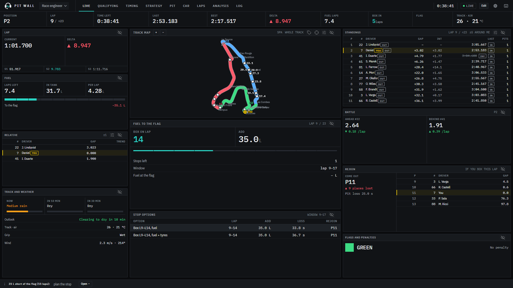
</p>

## What you get

| | |
|---|---|
| **Live car** | Laps, sectors, fuel, tyres, brakes, damage and driver inputs, up to 60 times a second. |
| **Whole-field timing** | Standings with gaps, intervals, sectors and stops; relative, battle trends, pit lane, flags and every car on the track map. |
| **Strategy, worked out for you** | When to box, how much fuel to add, how many stops are left, the pit window and where you'll rejoin. |
| **Remote pit stop** | The engineer sets fuel, tyres, compound, pressures, brake pads and repairs. Pit Wall enters it in the driver's game and checks it went in. |
| **Lap coach** | Finds the corners of a track from your own laps and shows, corner by corner, where time is lost and why. |
| **Your own layout** | 41 modules on drag-and-drop screens, five ready-made templates and your own colours. Works on a phone, too. |
| **3D damage view** | A GT3 painted green to red by what ACC reports for each zone, the suspension and the brakes. |
| **Private by design** | Runs on the driver's PC and connects over your own VPN. No account, no cloud. |

## A tour

Every screen below is the built-in simulator, running at Spa, Monza and the Nordschleife.

### Live

The wall: you on the left, the race in the middle, the field on the right. The map colours the sectors and labels each car with its gap to you. Fuel to the flag, the stop options and where you'd rejoin update every lap.

### Timing

<p align="center">
  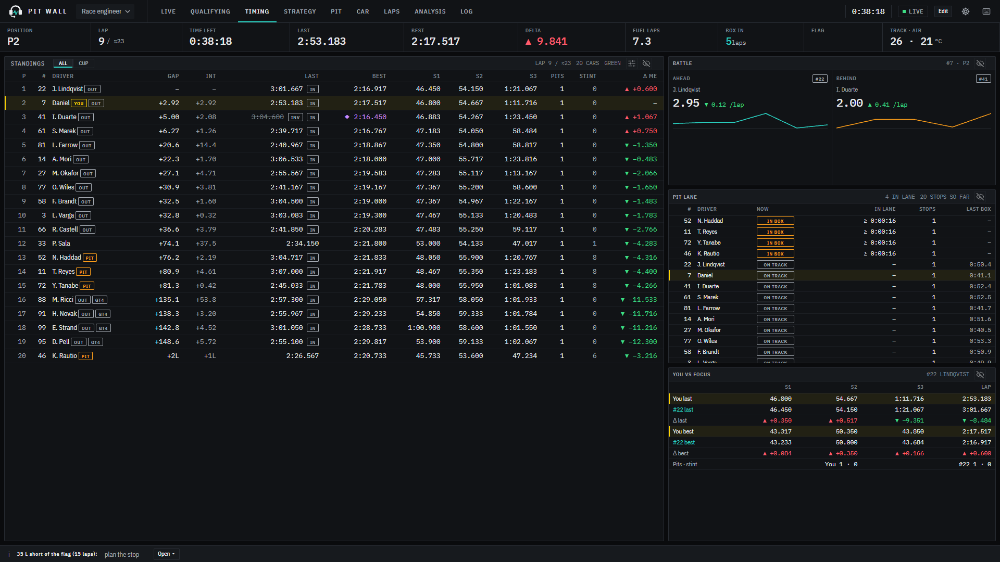
</p>

The whole field, with every lap and sector, who is in the pit lane, the battle ahead and behind with its trend, and your laps against any car you click.

### Strategy

<p align="center">
  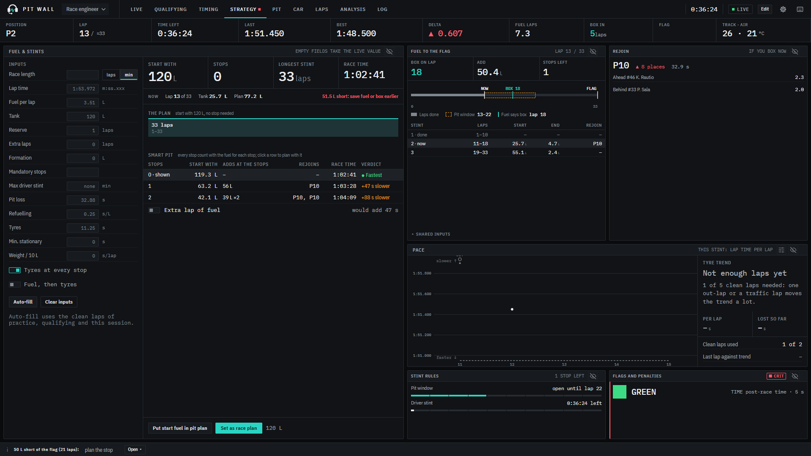
</p>

A race fuel and stint calculator, fed by the live car, next to the plan it builds: the stops, the fuel at each, the pace the tyres allow and where each stop puts you back on track.

### Pit stop

<p align="center">
  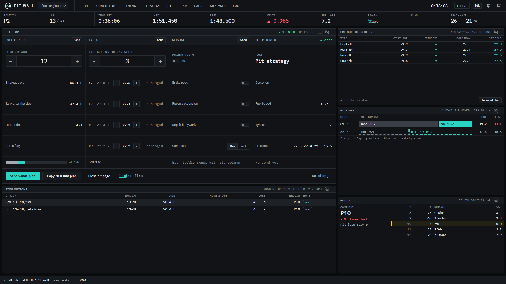
</p>

The plan on the left, what the driver's MFD holds right now beside it. Press *Send* and Pit Wall types it into the game and reads it back. Pressure corrections for the next stop come from the hot pressures at the line.

### Analysis and the lap coach

<p align="center">
  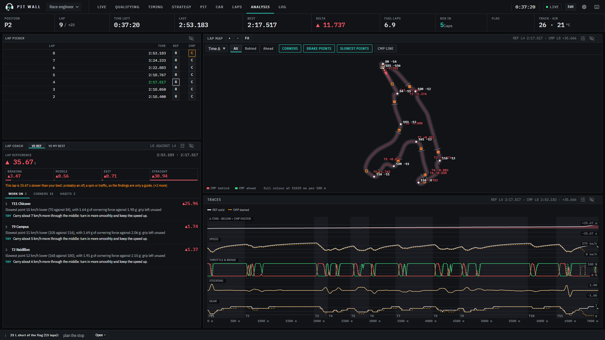
</p>

Pick two laps and compare them on the map and in the traces. The coach lists the corners where the time goes and what to work on in each.

<table>
  <tr>
    <td width="50%">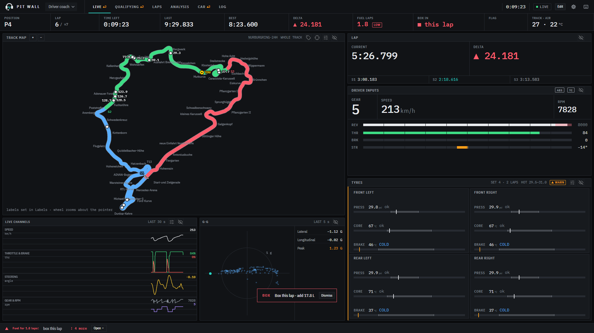</td>
    <td width="50%">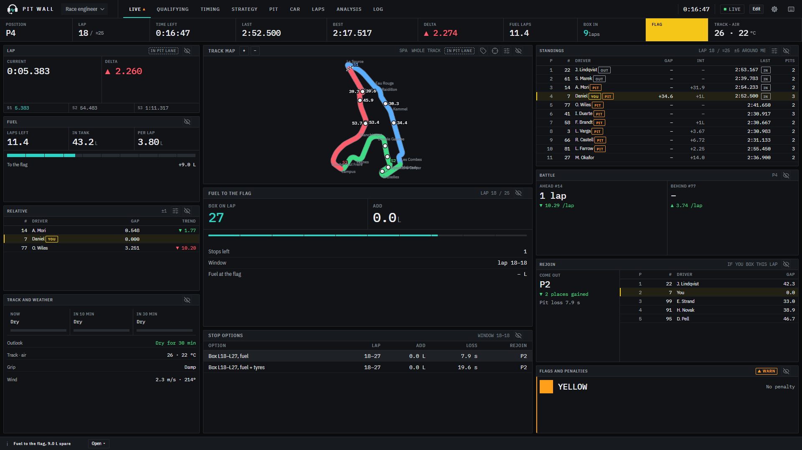</td>
  </tr>
  <tr>
    <td><b>Driver coach</b> on the Nordschleife: the full 24h layout, inputs, tyres, live channels and G-G.</td>
    <td><b>Flags</b> as the driver sees them: a yellow at Spa, in the top bar and in Flags and penalties.</td>
  </tr>
  <tr>
    <td>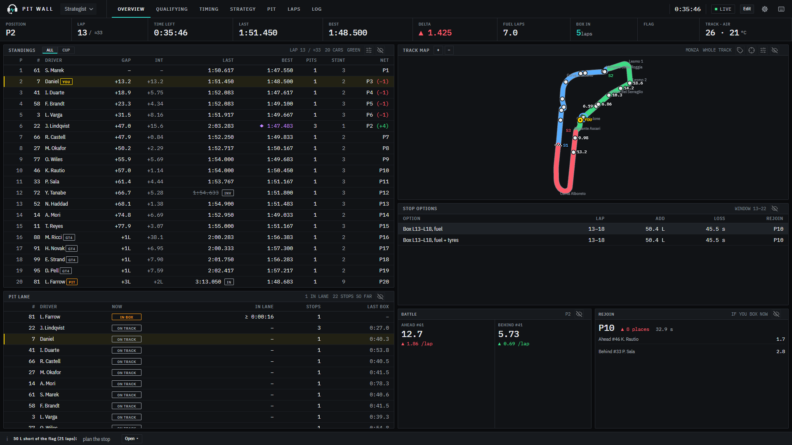</td>
    <td>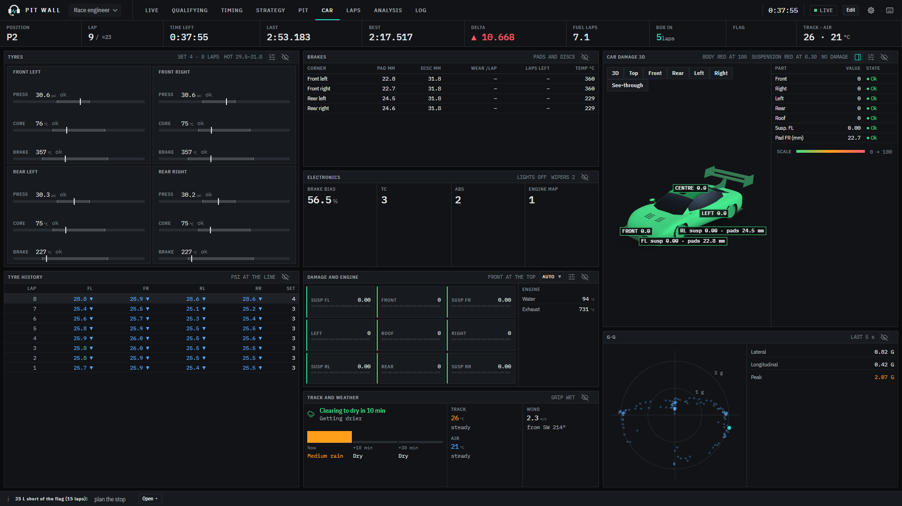</td>
  </tr>
  <tr>
    <td><b>Strategist</b>: the field with net positions after everyone's stops, and the pit lane.</td>
    <td><b>Car</b>: tyres corner by corner, brakes, electronics, weather and the 3D damage view.</td>
  </tr>
</table>

### Your own layout

<p align="center">
  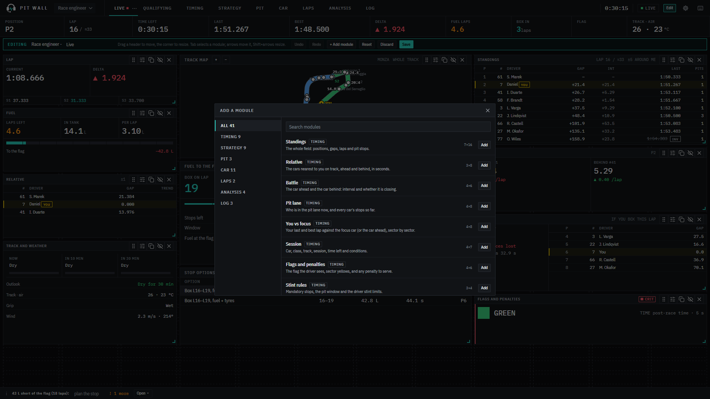
</p>

Press **E**: drag a module by its header, resize it from the corner, add any of the 41 modules from the catalogue or remove one. Make your own workspaces and templates, and export them to share. Five templates come ready: Race engineer, Race weekend, Strategist, Driver coach and Minimal.

<table>
  <tr>
    <td width="45%">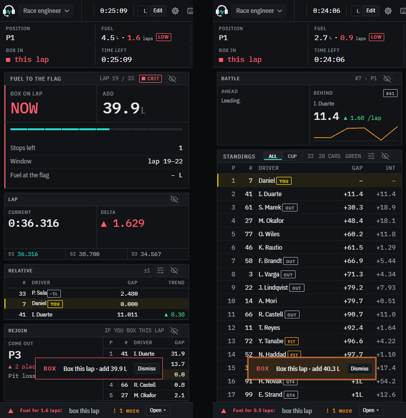</td>
    <td><b>On a phone</b>, the screens stack into one column, so the engineer can follow from the pit box or the sofa. Alerts such as <i>Box this lap</i> pop up wherever you are.</td>
  </tr>
</table>

## Get started

**Driver's PC** (Windows, where ACC runs): download **[Pit Wall](https://github.com/simdex-org/pit-wall/releases/latest)**, either the installer (`Pit.Wall_x.y.z_x64-setup.exe`) or the portable `PitWall.exe`, which needs no install. Everything it needs is inside.

1. Open Pit Wall. It picks your Hamachi address (see [Connect the two PCs](#connect-the-two-pcs)); change it or the port if you need to.
2. Press **Start Pit Wall**. It switches on ACC's broadcasting for the other cars' timing if it is off (restart ACC once afterwards).
3. Send your engineer the link it shows. Only people with the key in the link can send pit plans; everyone else can just watch.
4. Start ACC and drive. **Stop** ends it without closing the window, and **Update** brings in a new version when there is one.

**Engineer's PC:** open the link. Nothing to install, only a browser.

<details>
<summary><b>From source</b> (Node.js 22 or newer and pnpm)</summary>

```bash
git clone https://github.com/simdex-org/pit-wall
cd pit-wall
pnpm install
pnpm --filter @pitwall/web build
pnpm --filter @pitwall/bridge start -- --http 25.x.x.x:8765
```

The bridge prints the link for the engineer:

```
Engineer, open:   http://25.40.144.183:8765/?key=4oX0dSGyk-ZpSt5I3lZq0w
```

Once, with ACC closed, switch on timing for the other cars: `pnpm --filter @pitwall/bridge start -- --enable-broadcast`. More in [development](docs/development.md).

</details>

## Connect the two PCs

The engineer's browser reaches the driver's PC on port **8765** over a VPN. Nothing is opened to the internet.

1. Install [Hamachi](https://vpn.net/) on both PCs and sign in.
2. Driver: *Network → Create a new network*. Engineer: *Network → Join an existing network*.
3. The driver's `25.x.x.x` address at the top of the Hamachi window is the one Pit Wall uses.
4. Driver, once, in PowerShell **as administrator**, so Windows does not treat Hamachi as a public network:

   ```powershell
   Set-NetConnectionProfile -InterfaceAlias "Hamachi" -NetworkCategory Private
   ```

   Then allow Pit Wall on **Private** networks only when Windows asks.

**ZeroTier:** join both PCs to one network, authorise both, use the driver's ZeroTier address. **Tailscale:** same account on both, use the driver's `100.x.x.x` address.

## Try it without ACC

The built-in simulator runs a whole session with a 20-car field: traffic, passes, spins, local yellows and full course yellows, rain showers, pit stops and a working pit page.

```bash
pnpm --filter @pitwall/bridge start -- --simulate-acc --key demo
```

| Variant | Add |
|---|---|
| Qualifying, practice, or a whole weekend | `--sim-session quali` (or `practice`, `weekend`) |
| A real layout at a GT3's pace | `--sim-track spa` (or `monza`, `nurburgring`, `silverstone`, `suzuka`, and 20 more) |
| The Nordschleife 24h, 8x faster | `--sim-track nordschleife --sim-speed 8` |
| A shorter or longer session | `--sim-minutes 30` |

## Good to know

- Pit Wall works the pit menu the way a driver would, with the keys. ACC has to be the window in focus, and a plan takes 15 to 30 seconds to go in. Driving on keyboard and mouse? Use vJoy: see the [guide](docs/GUIDE.md#what-pit-control-can-and-cannot-do).
- **Try it once in practice before a race.**
- Everything else (every option, the modules, templates, the pit page, troubleshooting) is in the **[guide](docs/GUIDE.md)**.

## Credits

- By [Simdex](https://github.com/simdex-org): William19D and Simplezes. [MIT License](LICENSE).
- 3D car: [three.js](https://github.com/mrdoob/three.js) 0.160.0, MIT. Fonts: [IBM Plex Sans Condensed and IBM Plex Mono](https://github.com/IBM/plex), SIL OFL.
- ACC's shared memory layout: Kunos' *ACC Shared Memory Documentation* 1.8.12. The pitstop MFD layout and navigation: [Simulator Controller](https://github.com/SeriousOldMan/Simulator-Controller).
- Nürburgring 24h layout traced from Wikimedia Commons *Circuit Nürburgring-2002-24h.svg* (Pitlane02, CC BY-SA 3.0). Other outlines: © [OpenStreetMap contributors](https://www.openstreetmap.org/copyright), [ODbL](https://opendatacommons.org/licenses/odbl/1-0/).
