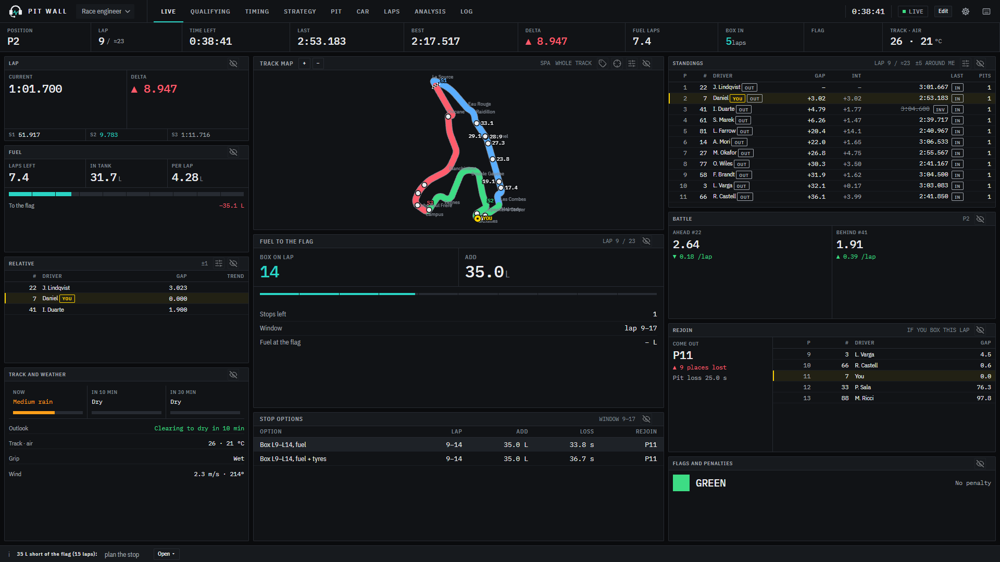
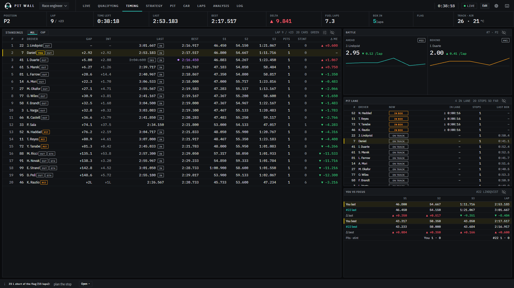
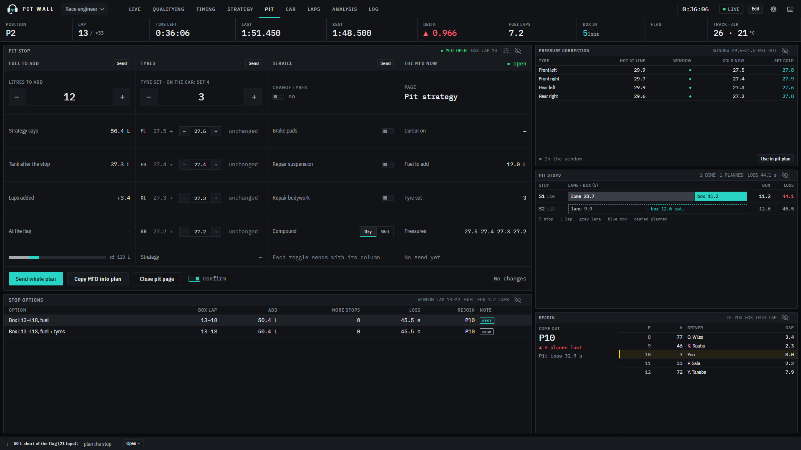
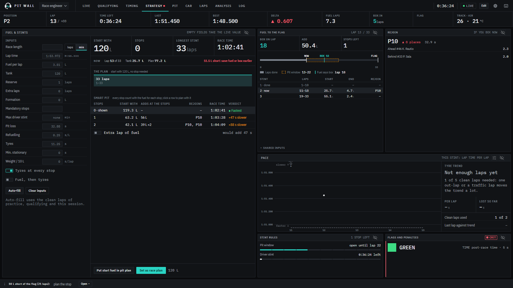
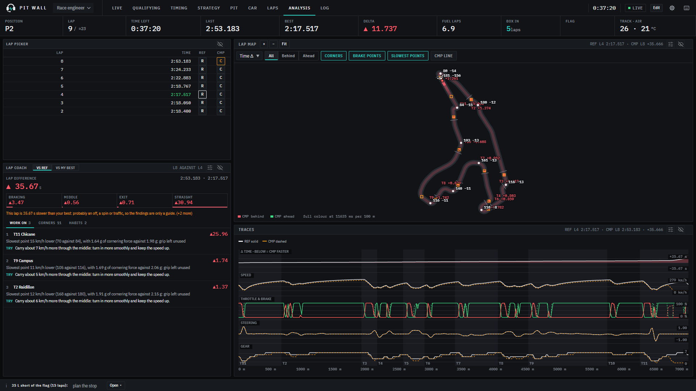

<p align="center">
  <picture>
    <source media="(prefers-color-scheme: dark)" srcset="screenshots/logo.svg">
    
  </picture>
</p>

<p align="center">
  Watch your driver live in Assetto Corsa Competizione, and set their next pit stop from your browser.
</p>

<p align="center">
  <a href="https://github.com/simdex-org/pit-wall/releases/latest"><b>Download</b></a> ·
  <a href="#get-started">Get started</a> ·
  <a href="#connect-the-pcs">Connect</a> ·
  <a href="#try-it-without-acc">Demo</a>
</p>

<p align="center">
  
</p>

## What it does

- **Live car and whole-field timing:** laps, fuel, tyres, damage, gaps, pit lane, flags, every car on the map.
- **Strategy done for you:** when to box, how much fuel, stops left, where you rejoin.
- **Remote pit stop:** set fuel, tyres, pressures, pads and repairs. Pit Wall enters them in the driver's game and checks they went in.
- **Lap coach:** shows corner by corner where a lap loses time.
- **Your layout:** drag-and-drop modules, five templates, works on a phone. Write your own modules in HTML ([how](docs/custom-modules.md)).
- **Private:** runs on the driver's PC over your own VPN. No account, no cloud.

<table>
  <tr>
    <td width="50%"></td>
    <td width="50%"></td>
  </tr>
  <tr>
    <td width="50%"></td>
    <td width="50%"></td>
  </tr>
</table>

## Get started

**Driver (Windows):** download [Pit Wall](https://github.com/simdex-org/pit-wall/releases/latest) (installer or portable `PitWall.exe`), press **Start**, send the engineer the link it shows. Start ACC and drive.

**Engineer:** open the link in a browser. Nothing to install.

Only people with the key in the link can send pit plans. Everyone else just watches.

<details>
<summary>From source (Node.js 22+, pnpm)</summary>

```bash
git clone https://github.com/simdex-org/pit-wall
cd pit-wall
pnpm install
pnpm build
pnpm --filter @pitwall/bridge start --http 25.x.x.x:8765
```

Once, with ACC closed, switch on timing for the other cars: `pnpm --filter @pitwall/bridge start --enable-broadcast`.

</details>

## Connect the PCs

Both PCs join the same VPN (Hamachi, ZeroTier or Tailscale). Pit Wall uses the driver's VPN address, and nothing is opened to the internet. With Hamachi, run this once as administrator on the driver's PC, then allow Pit Wall on private networks only:

```powershell
Set-NetConnectionProfile -InterfaceAlias "Hamachi" -NetworkCategory Private
```

## Share the car with a teammate

In an endurance race each driver runs Pit Wall on their own PC. In the Pit Wall window, switch **Solo** to **Team** and type a team code: any 12 or more letters, digits, dashes or underscores, the same on every driver's PC. The first driver to start leaves **Teammate's IP** empty; the others type that driver's IP address (add `:8770` if they use another port than 8765). On the command line that is `--team-code CODE` and `--team 25.1.2.3`. The bridges introduce each other, so with three or more drivers each PC still needs only one address. They then share laps, stints, stops, the pit log, settings and the stint plan. The dashboard on every PC shows the car from the PC of whoever is driving, so strategy and fuel use carry on after a swap, and pit plans go to the game of the driver in the car. Field timing (ACC's broadcasting) must be on, since that is how the bridges tell who is in the car. A bridge with another code is refused, and the code is never needed by the engineer: their link keeps its own access key.

To see who is quicker where, add the **Teammate laps** module (Analysis group): each driver's best and typical lap, and corner by corner where one gains or loses time on the other, with the likely cause. **Open in Traces**, or a click on a corner, sends both laps to Traces, Lap map and Lap coach. The Laps table and the Lap picker show who drove each lap.

## Try it without ACC

```bash
pnpm --filter @pitwall/bridge start --simulate-acc --key demo
```

A full session with a 20-car field and a working pit page. Add `--sim-session quali` for qualifying or `--sim-track spa` for another track. To try a driver swap, start two bridges on different ports with `--sim-driver 1` and `--sim-driver 2`, both with `--team-code` and the same code, the second also with `--team 127.0.0.1:PORT` of the first. Open the second page at `localhost` rather than `127.0.0.1`: both bridges set the same sign-in cookie, and browsers keep one per host, not per port.

## Good to know

- ACC must be the focused window while a plan goes in, which takes 15 to 30 seconds. Try it once in practice before a race.

## CI and releases

<details>
<summary>What CI checks, and how to cut a release</summary>

Every pull request and every push to `main` runs [CI](.github/workflows/ci.yml):

- **Typecheck** of every package.
- **Tests** of the page, the launcher and the tracks, and the **bridge tests** on Windows (Node 24) and Linux (Node 22, the Windows-only tests skip).
- **Build** of the page and the bridge bundle, then a **smoke test** (`pnpm smoke`): the built bridge runs the simulator, and a headless Chromium checks the page loads, a wrong key gets 403, `/events` streams, a lap completes, and every built-in workspace shows its modules with no errors in the page.
- **Launcher**: the Tauri app compiles, installer and portable builds (`cargo check`).
- **Audit and commit hygiene**: `pnpm audit` of the shipped dependencies at high severity (the dev dependencies are reported but do not fail the run), and no AI co-author trailers in the commits or the PR description.

To release:

1. Bump the version in `package.json` and `apps/launcher/src-tauri/Cargo.toml`, run `cargo check` in `apps/launcher/src-tauri` so `Cargo.lock` follows, and merge that to `main`.
2. On GitHub, open **Actions**, then **Release**, then **Run workflow** on `main`. Type the same version (for example `1.0.7`). Leave **draft** ticked to read the notes over before anyone sees them; tick **pre-release** for a test build.
3. The workflow checks the version, runs all of CI, builds the installer (`PitWall_<version>_x64-setup.exe`) and the portable `PitWall.exe`, and creates the release `v<version>` with both files, `SHA256SUMS.txt` and notes generated from the merged pull requests.
4. For a draft, edit the notes on the Releases page and press **Publish**. The app only offers the latest published, non-pre-release version as an update, and it picks the file by name, so keep the names.

No secrets are needed. The files are not code-signed, so Windows SmartScreen may warn on first run, as it does today.

</details>

## Credits

By [Simdex](https://github.com/simdex-org): William19D and Simplezes. [MIT License](LICENSE).
